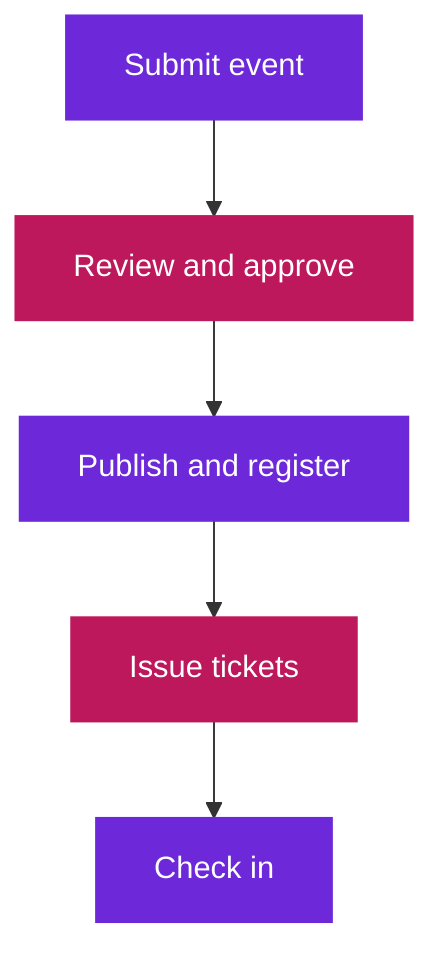

<h1 align="center">🎟️ EventHub — School Event Command Center</h1>

<p align="center"><strong>From event approval to the last QR check-in.</strong></p>

<p align="center">
  
  
  
</p>

<p align="center">
  <a href="#project-summary">Project summary</a> · <a href="#event-approval-workflow">Event Approval Workflow</a> · <a href="#digital-tickets">Digital Tickets</a> · <a href="#supabase-setup-requirements">Supabase Setup Requirements</a>
</p>

---


EventHub is a full-stack school event management platform built to keep students, teachers, parents, event staff, and school administrators informed and coordinated across the complete event lifecycle.

It combines a public event portal, student self-service area, and a role-based administration CMS with event approvals, registrations, waitlists, digital tickets, QR check-in, announcements, live updates, media highlights, societies, user administration, analytics, and audit logging.

> This README is based on the supplied project source. Database SQL migrations, RLS policy definitions, and the bodies of several Supabase RPC functions are not included in the repository package, so their internal SQL behavior is not documented here.

---

## Project summary

EventHub gives a school one place to run events from initial approval through attendance reporting. The public portal handles discovery and registration, the student portal tracks registrations and tickets, and the CMS supports review, publishing, and event-day operations.

| Task | Where to start |
| --- | --- |
| Find and register for an event | [Event listings](src/pages/Events.jsx) and [registration](src/pages/Register.jsx) |
| Review registration and ticket status | [Student registrations](src/pages/StudentRegistrations.jsx) and [ticket wallet](src/pages/StudentTickets.jsx) |
| Approve an event and check in attendees | [Approval queue](src/pages/ApprovalQueue.jsx) and [check-in](src/pages/AdminCheckIn.jsx) |
| Follow routes and access checks | [Route definitions](src/App.jsx) and [permission mapping](src/utils/permissions.js) |

The frontend uses React, Vite, and React Router. Supabase supplies backend services. Use `npm run dev`, `npm run lint`, and `npm run build` from the repository root after installing dependencies. The Supabase setup section below describes the backend required for end-to-end workflows.

## Core Features

### Public Event Platform

- Event discovery and event detail pages
- Search and category filtering
- Interactive event calendar
- Event countdown/status presentation
- Public announcements
- Event registration
- Capacity tracking
- Waitlist entry when an event is full
- Live event updates
- Event status handling for upcoming, live, completed, postponed, and cancelled events

### Student Portal

- Student account signup and login
- Protected student dashboard
- Student profile validation
- Confirmed registration history
- Waitlist status
- Waitlist-promotion notifications
- Digital ticket wallet
- QR ticket display
- Printable tickets
- Check-in status visibility

### Administration CMS

- Event creation and editing
- Multi-stage event approval workflow
- Principal approval override
- Announcements management
- Registration administration
- Waitlist promotion/cancellation
- CSV attendance export
- Event Staff assignment
- QR/manual ticket verification
- Attendee check-in
- Live event updates
- Media/highlight management
- Society management
- Teacher-in-Charge assignment
- CMS user/role management
- Per-user permission overrides
- Dashboard analytics
- Activity/audit logs

---

## User Types

### Public Visitor

No account is required to browse public EventHub content. Visitors can discover events, view event details, browse the calendar, read announcements, and use public registration/waitlist flows.

### Student

Authenticated students can use the protected student portal to:

- View their dashboard
- View notifications
- Mark notifications as read
- View confirmed registrations
- Track waitlist entries
- View promoted waitlist entries
- Access digital tickets
- Display ticket QR codes
- Check ticket check-in state
- Print tickets

### CMS Roles

EventHub implements five CMS roles:

| Role | Primary responsibility |
|---|---|
| Principal | Full administration, governance, approvals, publishing, users, logs |
| Vice Principal | Final event approval/publishing and senior content management |
| Teacher-in-Charge | Society-scoped event management and Student Admin review |
| Student Admin | Society-scoped event creation/content management |
| Event Staff | Event-day ticket verification and attendee check-in |

---

## Role-Based Access Control

EventHub combines **role defaults** with **per-user permission overrides**.

If an explicit override exists for a permission, that Boolean value replaces the default for that user. Otherwise, the user's role default applies.

### Default Permission Matrix

| Permission | Principal | Vice Principal | Teacher-in-Charge | Student Admin | Event Staff |
|---|:---:|:---:|:---:|:---:|:---:|
| `manageUsers` | ✓ |  |  |  |  |
| `manageSocieties` | ✓ | ✓ |  |  |  |
| `manageEvents` | ✓ | ✓ | ✓ | ✓ |  |
| `publishEvents` | ✓ | ✓ |  |  |  |
| `manageAnnouncements` | ✓ | ✓ |  |  |  |
| `manageRegistrations` | ✓ |  | ✓ |  |  |
| `manageMedia` | ✓ | ✓ | ✓ | ✓ |  |
| `manageLiveUpdates` | ✓ | ✓ | ✓ | ✓ |  |
| `approveEvents` | ✓ | ✓ | ✓ |  |  |
| `viewAnalytics` | ✓ | ✓ |  |  |  |
| `viewLogs` | ✓ |  |  |  |  |
| `checkInAttendees` | ✓ |  |  |  | ✓ |

Some pages also contain role-specific business rules in addition to permission checks. For example, society deletion is explicitly Principal-only.

---

## Event Approval Workflow



EventHub separates an event's **operational status** from its **approval status**.

### Student Admin Path

```text
Draft
  ↓
Student Admin submits
  ↓
Teacher Review
  ↓
Teacher-in-Charge approves
  ↓
Vice Principal Review
  ↓
Vice Principal approves
  ↓
Published
```

The Teacher-in-Charge review is society-scoped.

### Teacher-in-Charge Path

```text
Draft
  ↓
Teacher submits
  ↓
Vice Principal Review
  ↓
Vice Principal approves
  ↓
Published
```

### Changes Requested

An authorized reviewer can return an event for correction.

```text
Pending Review
  ↓
Changes Requested
  ↓
Creator edits event
  ↓
Resubmission
  ↓
Approval workflow continues
```

### Rejection

Authorized reviewers can reject an event. Rejection is distinct from requesting changes.

### Principal Override

The Principal has exceptional governance capabilities. The approval implementation allows Principal intervention in pending review stages, including override behavior and publication paths. Override actions are recorded in approval/activity history.

### Approval Concurrency Protection

Approval updates include the currently expected approval state in the update condition. If another administrator changes the event first, the stale action fails and the queue refreshes instead of silently applying a second decision.

---

## Event Statuses

Operational event states recognized by the application include:

- `upcoming`
- `registration_open`
- `live`
- `completed`
- `postponed`
- `cancelled`

Approval states recognized across the application include:

- `draft`
- `teacher_review`
- `vp_review`
- `changes_requested`
- `rejected`
- `approved`
- `published`

These are separate concepts. A published event can still move through real-world operational states such as live, completed, postponed, or cancelled.

---

## Registration and Waitlist Flow

```text
Open Event
    ↓
Registration enabled?
    ↓
Capacity available?
   / \
 Yes  No
  ↓    ↓
Register  Join Waitlist
  ↓
Ticket generated
  ↓
QR / Ticket ID
  ↓
Event-day verification
  ↓
Check-in
```

### Direct Registration

When registration is available and capacity remains, EventHub creates a registration and generates ticket data for the attendee.

### Waitlist

When an event is full, attendees can join `event_waitlist`.

The application distinguishes waitlist states including:

- `waiting`
- `promoted`
- `cancelled`

Authorized registration managers can promote waiting attendees through the `promote_waitlist_entry` RPC when capacity becomes available.

---

## Digital Tickets

Confirmed registrations can expose digital tickets containing:

- Event information
- Attendee information
- Ticket identifier/code
- QR representation
- Event state
- Check-in state

Students can access their tickets through the protected ticket wallet and print them when needed.

---

## Event Check-In

> [!TIP]
> Use the QR scanner at the entrance. The CMS also supports manual ticket verification.

EventHub supports both:

1. Manual ticket-code verification
2. Camera-based QR scanning

The check-in process uses server-side RPCs rather than trusting the QR content alone.

```text
Scan QR / Enter Ticket ID
          ↓
      Verify Ticket
          ↓
  Display attendee/event
          ↓
    Confirm Check-In
          ↓
   Registration updated
```

The interface detects already checked-in tickets and handles authorization/event-assignment errors.

Event Staff can be assigned to specific events through event staff assignments.

---

## Announcements

Authorized administrators can:

- Create announcements
- Edit announcements
- Delete announcements
- Set announcement type
- Set publication date/time
- Search/filter announcements

The public announcement archive provides search and type filtering.

Announcements do not use the same multi-stage approval queue as events in the supplied frontend.

---

## Live Event Updates

Authorized users can publish updates associated with an event.

The public event detail page subscribes to event-update changes, allowing new updates to appear without a full page refresh.

Typical flow:

```text
CMS → Select Event → Write Update → Publish
                              ↓
                    Public Event Page
                              ↓
                      Realtime Refresh
```

---

## Media & Highlights

The media module supports event-linked media/highlight records.

Features include:

- Image/video media types
- Event association
- Title/content metadata
- Media URL
- Create/edit/delete
- Search/filter
- Published/unpublished state

The supplied `AdminMedia` implementation is URL-driven. A direct binary file upload implementation is not present in that page.

---

## Society Management

Societies are used for organizational ownership and approval scoping.

Authorized administrators can:

- Create societies
- Edit societies
- Search societies
- Assign a Teacher-in-Charge
- View assigned teachers

Teacher and Student Admin CMS accounts require a society assignment in the user-management flow.

### Society Deletion

Deletion is explicitly Principal-only.

A society cannot be deleted while:

- A Teacher-in-Charge is still assigned
- Events still reference the society

Dependencies must be removed first.

---

## CMS User Administration

The Principal can administer CMS accounts through protected Supabase Edge Functions.

Supported user-management operations include:

- Create CMS account
- Edit CMS account
- Change role-related profile information
- Assign society
- Configure permission overrides
- Activate/deactivate account
- Delete eligible CMS users

Teacher and Student Admin accounts require a society.

The CMS user-creation function permits creation of:

- Vice Principal
- Teacher
- Student Admin
- Event Staff

Principal creation is intentionally excluded from the allowed role list in the supplied creation function.

---

## Activity Logging

Administrative and workflow actions are recorded in `activity_logs`.

Logs can preserve:

- Action
- Entity type
- Entity ID
- Actor
- Structured action details

Approval decisions are additionally recorded through `event_approvals`.

The Principal has `viewLogs` by default.

---

## Dashboard & Analytics

The CMS dashboard aggregates operational information from events, registrations, CMS profiles, societies, activity logs, and an analytics RPC.

Dashboard indicators include event and attendance-oriented information such as:

- Published events
- Pending approvals
- Active users
- Check-ins
- Upcoming events
- Today's events
- Sold-out events
- Live events
- Top-event information

`viewAnalytics` is granted to Principal and Vice Principal by default.

---

## Public Routes

**Choose a portal**

| Area | Start here |
| --- | --- |
| Visitors | Events, calendar, and announcements |
| Students | Registrations and digital tickets |
| Event staff | Ticket verification and check-in |

| Route | Purpose |
|---|---|
| `/` | Home |
| `/events` | Event catalogue |
| `/events/:id` | Event details |
| `/calendar` | Interactive event calendar |
| `/announcements` | Public announcements |
| `/register/:id` | Registration / waitlist |
| `/student/login` | Student login |
| `/student/signup` | Student signup |
| `/student/dashboard` | Student dashboard |
| `/student/registrations` | Student registration history |
| `/student/tickets` | Student ticket wallet |

---

## CMS Modules

The administration area includes:

| Module | Main permission |
|---|---|
| Dashboard | CMS access / role restrictions |
| Events | `manageEvents` |
| Approval Queue | `approveEvents` |
| Announcements | `manageAnnouncements` |
| Media & Highlights | `manageMedia` |
| Registrations | `manageRegistrations` |
| Event Check-in | `checkInAttendees` |
| Live Updates | `manageLiveUpdates` |
| Societies | `manageSocieties` |
| Users & Roles | `manageUsers` |
| Activity Logs | `viewLogs` |

---

## Supabase Edge Functions

The supplied project includes privileged CMS user-management Edge Functions:

- `create-cms-user`
- `delete-cms-user`
- `src`
- `update-cms-user`

These functions perform sensitive Auth administration server-side rather than exposing administrator credentials to the browser.

---

## Tech Stack

- **React** — `^19.2.8`
- **React DOM** — `^19.2.8`
- **React Router** — `^7.18.2`
- **Supabase JavaScript Client** — `^2.112.3`
- **Vite** — `^8.2.0`
- **QR Code rendering** — `^4.2.0`
- **QR scanning** — `^2.3.8`

---

## Supabase Setup Requirements

A working deployment needs the backend resources expected by the source code.

At minimum, configure:

1. Supabase Authentication
2. Required application tables
3. Foreign-key relationships
4. Row Level Security
5. Policies matching the role/ownership model
6. Required RPC functions
7. Supabase Realtime for live event updates where required
8. User-management Edge Functions
9. Edge Function secrets/environment variables
10. Appropriate indexes for event, registration, waitlist, profile, and log queries

> The SQL definitions are not included in the supplied ZIP. Deploying only the React application is therefore not sufficient to reproduce the complete backend.

---

## Passwords & Account Access

EventHub does **not** contain hard-coded user passwords in the supplied source. Passwords are created and managed through Supabase Authentication.

### CMS Account Passwords

CMS accounts are created by the Principal through **Users & Roles**.

When creating a CMS user:

- The Principal must enter a **temporary password**.
- The temporary password must contain **at least 8 characters**.
- The password is passed to the protected `create-cms-user` Supabase Edge Function.
- The Edge Function repeats the minimum-length validation before creating the authentication account.
- CMS users sign in using their assigned email address and password at `/admin/login`.
- Invalid credentials are reported as **Invalid email or password**.

When editing a CMS account:

- The Principal may enter a **new password**.
- The new password must contain **at least 8 characters**.
- Leaving the password field blank keeps the current password unchanged.
- Password changes are handled through the protected `update-cms-user` Edge Function.

### Student Passwords

Students choose their own password during signup.

The implemented student password rules are:

- Minimum **8 characters**
- Password and confirmation password must match
- Student accounts are created through Supabase Authentication
- Students sign in through `/student/login`

If the password is too short, EventHub displays:

```text
Password must contain at least 8 characters.
```

If the two password fields do not match, EventHub displays:

```text
Passwords do not match.
```

### Password Summary

| Account | Password set by | Minimum length | Notes |
|---|---|---:|---|
| Principal | Existing Supabase/Auth configuration | 8 characters where managed through the supplied CMS workflow | Protected Principal account |
| Vice Principal | Principal | 8 characters | Principal can set a new password |
| Teacher-in-Charge | Principal | 8 characters | Principal can set a new password |
| Student Admin | Principal | 8 characters | Principal can set a new password |
| Event Staff | Principal | 8 characters | Principal can set a new password |
| Student | Student during signup | 8 characters | Password confirmation required |

### Demo accounts

Use an isolated Supabase project for demo accounts and provide credentials through a restricted channel. Assign the Teacher-in-Charge and Student Admin to the same demo society. Assign Event Staff to the demo event for ticket verification and check-in testing.

### Demo Account Seeder

A one-time server-side seed script can create or update all six demo accounts together. The script should use a Supabase secret/service-role credential through an environment variable, never a `VITE_...` variable or publishable key.

Run it from the project root with:

```powershell
$env:SUPABASE_SECRET_KEY="YOUR_SECRET_KEY"
node seed-demo-users.js
Remove-Item Env:SUPABASE_SECRET_KEY
```

The seeder creates or updates one Principal, Vice Principal, Teacher-in-Charge, Student Admin, Event Staff, and Student account, and creates/uses a demo society for the society-scoped roles. Never commit the Supabase secret key to the repository.

---

## Security Notes

- Never place a Supabase service-role key in frontend environment variables.
- Privileged Auth administration should remain inside protected Edge Functions.
- UI permission checks improve UX but should not be treated as the sole authorization layer.
- Mirror authorization rules in RLS policies, RPC authorization, and Edge Functions.
- Event Staff should only be able to check in attendees for events they are authorized/assigned to.
- Validate approval transitions server-side where possible.
- Keep permission overrides narrow and auditable.
- Maintain activity logs for privileged administrative operations.
- Use HTTPS in production.
- Review database policies before production deployment.

---

## Operational Workflow

A typical full event lifecycle is:

```text
Create Event
    ↓
Save Draft
    ↓
Submit for Approval
    ↓
Teacher Review (Student Admin-created event)
    ↓
Vice Principal Review
    ↓
Publish
    ↓
Public Discovery
    ↓
Registration
    ↓
Capacity Reached → Waitlist
    ↓
Ticket / Promotion
    ↓
QR Verification
    ↓
Event Check-In
    ↓
Live Updates
    ↓
Media / Highlights
    ↓
Completed Event
```

---

## Important Project Boundaries

The supplied source does **not** establish a dedicated Parent account type. Parents can use public-facing features, but this README does not claim a separate parent dashboard.

The source package also does not contain the database SQL migrations/RLS definitions or full RPC implementations. Any documentation of those internals would require the corresponding Supabase SQL source.

---

## Documentation

For detailed operational guidance, refer to the EventHub **User & Administration Manual**, which documents:

- Every user type
- Permission matrix
- Event workflows
- Approval paths
- Registration and waitlist behavior
- Ticket/check-in process
- CMS modules
- Society/user administration
- Troubleshooting and governance

---

## Project Goal

EventHub was designed as a scalable digital command center for school events—centralizing event communication, approval, registration, attendance, and live engagement in one clean platform.

It addresses the challenge of managing many school activities across the year while giving each user only the capabilities needed for their role.

---

## License

No license was identified from the supplied project source for this README. Add an appropriate `LICENSE` file before distributing the project under a specific open-source license.
